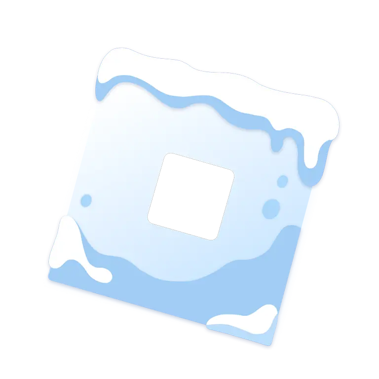

<h1 align="center">
    Depthstrap
</h1>

<p align="center">
    A Roblox bootstrapper for Deepwoken players, forked from <a href="https://github.com/Froststrap/Froststrap"><strong>Froststrap</strong></a>.
</p>

<p align="center">
    
</p>

<div align="center">

[![License][badge-repo-license]][repo-license]
[![Version][badge-repo-latest]][repo-latest]

</div>

> [!NOTE]
> Depthstrap is a **launcher**, not a cheat. It does not inject into Roblox, read game memory, or automate gameplay.
> Everything it does happens outside the game client, the same way Bloxstrap/Fishstrap/Froststrap work.

---

## Deepwoken features (planned)

- **Location-aware Discord status** – shows whether you're in Etris, the Depths, Layer 2, etc., based on which Deepwoken place you joined
- **Server tools** – pick a server region, rejoin your last server, keep favourite servers
- **Build & notes panel** – keep build notes and quick links to the wiki and build planners
- **Deepwoken performance preset** – one-click FastFlag/graphics profile tuned for Deepwoken

## Inherited from Froststrap

- Auto-rejoin after inactivity disconnects, Discord Rich Presence, Roblox Studio RPC
- Multi-mod system, community mods, custom cursors/fonts/sounds
- FastFlag profiles with Roblox allowlist checking
- Customizable launcher themes and backgrounds
- Update channel switching, update blocking, fixed version folder
- Import settings from Fishstrap/Bloxstrap, game shortcuts, region selector, account manager

## Building

See [BUILDING.rst](BUILDING.rst). In short, on Windows you need the .NET 10 SDK, the Rust toolchain
(stable is fine) and the Visual Studio C++ Build Tools, then:

```bash
git clone --recursive https://github.com/overcookedspaghetti/Depthstrap
cd Depthstrap
dotnet build
```

Every push is also built by GitHub Actions; the installer is attached to the workflow run as an artifact.

## Credits & license

Depthstrap is a fork of [Froststrap](https://github.com/Froststrap/Froststrap), which is derived from
[Fishstrap](https://github.com/fishstrap/fishstrap) and [Bloxstrap](https://github.com/bloxstraplabs/bloxstrap).
All credit for the original code goes to their authors and contributors.

New code is licensed under the [Mozilla Public License 2.0](LICENSE), like Froststrap. Original copyright
notices are kept in each file, and third-party licenses are in [LICENSES](LICENSES).

Depthstrap is not affiliated with Roblox, Deepwoken, or the Froststrap/Fishstrap/Bloxstrap projects.

[badge-repo-license]:    https://img.shields.io/github/license/overcookedspaghetti/Depthstrap?style=for-the-badge&color=2b6cb0
[badge-repo-latest]:     https://img.shields.io/github/v/release/overcookedspaghetti/Depthstrap?style=for-the-badge&color=2b6cb0

[repo-license]:          https://github.com/overcookedspaghetti/Depthstrap/blob/main/LICENSE
[repo-latest]:           https://github.com/overcookedspaghetti/Depthstrap/releases/latest
